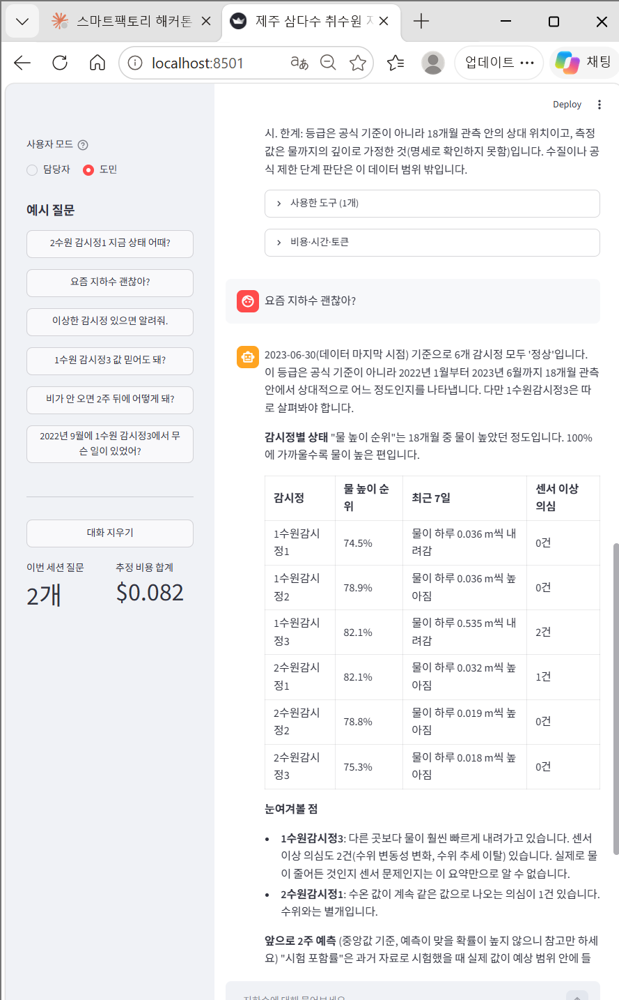

# 제주 삼다수 취수원 지하수 Agent

지하수 감시정 센서·기상 데이터를 분석해 지하수 상태를 말로 묻고 답하는 AI Agent입니다.

제주 AI·빅데이터 활용 AI Agent 개발 챌린지 출품작입니다.



**핵심 기능**
1. 센서 이상 진단: 순간 튐, 계단 변화, 값 고착, 추세 이탈, 변동성 변화를 '의심'으로 표시
2. 상태 진단: 18개월 관측 안의 상대 위치로 정상·주의·경고 안내
3. 2주 예측: 강수 가정 3가지별 1~14일 예측, 예상 범위와 신뢰도 표시

**사용 기술**: Python 3.12, Claude API(claude-sonnet-5-5, 도구 호출), pandas·numpy(규칙·통계 모델), matplotlib, Streamlit

**데이터 안내**: 데이터는 제주데이터허브(142·79·756·757번)에서 받아 `data/raw` 등에 넣어야 하며, 이 저장소에는 포함하지 않았습니다. 아래 '제출 ZIP' 관련 문장은 대회 제출본 기준입니다.

데이터 받는 방법 (자세한 내용은 아래 '환경변수'와 '데이터 준비' 절)
1. 제주데이터허브(jejudatahub.net)에서 회원가입 후 프로젝트를 만들고, 756·757번 데이터 페이지에서 '프로젝트 담기'를 누른 뒤 인증키를 `.env`의 `JEJU_DATAHUB_KEY`에 넣습니다.
2. 142번(지하수위)·79번(지하수온) CSV 4개를 내려받아 `data/raw`에 둡니다.
3. 756·757번은 API로 받습니다: `python src/test_station_api.py`(관측소 목록), `python src/collect_weather.py`, `python src/weather_clean.py`
4. 이후 '실행 순서'대로 전처리, 진단, 예측 모델 단계를 실행합니다.

---

제주개발공사의 지하수 감시정 센서 데이터(수위·수온)와 제주 기상 데이터(일 강수량)로 지하수 상태를 말로 묻고 답하는 AI Agent입니다. 센서 이상 진단, 상태 진단, 2주 예측을 도구로 만들고, Claude API(claude-sonnet-5-5)가 질문에 맞는 도구를 골라 부르고 결과를 설명합니다. 분석 계산은 규칙과 통계 모델이 하고 LLM은 예측하지 않습니다.

제조 공기업(제주개발공사)의 취수원 감시 센서 데이터에 설비 모니터링 방식(이상 유형 진단, 예측)을 적용했습니다.

기본 전제는 다음과 같습니다.
- 데이터는 2022-01-01 ~ 2023-06-30까지이며 '지금'은 2023-06-30 기준입니다.
- 측정값은 강수 뒤 값이 줄어드는 반응과 표선유역 연구를 근거로 '물까지의 깊이'로 해석했습니다. 해석이 달라지면 `src/config.py`의 `VALUE_IS_DEPTH` 한 줄(True/False)로 전환됩니다.
- 등급(정상/주의/경고)은 공식 기준수위가 아니라 18개월 관측 안의 상대 위치입니다.

## 폴더 구조

```
jeju-groundwater-agent/
├─ README.md
├─ requirements.txt        라이브러리 이름·버전
├─ .env.example            환경변수 예시(값 비어 있음). 복사해서 .env로 사용
├─ src/
│  ├─ preprocess.py        원본 CSV를 시간별 표로 병합
│  ├─ collect_weather.py   제주데이터허브 756번 일별 기상 수집 (허브 API 호출)
│  ├─ weather_clean.py     기상 캐시 병합, 관측소 고도 지역(zone) 추가
│  ├─ rain_analysis.py     강수와 수위의 시차 상관 확인
│  ├─ sensor_check.py      센서 이상 진단
│  ├─ status_check.py      상태 진단
│  ├─ forecast.py          2주 예측 모델
│  ├─ agent.py             Claude API Agent (도구 7개)
│  ├─ app.py               Streamlit 화면
│  ├─ config.py            측정값 방향 설정(VALUE_IS_DEPTH)
│  └─ test_station_api.py, test_weather_api.py   허브 API 확인용 스크립트
├─ data/
│  ├─ raw/                 원본 CSV 4개 (수정하지 않음)
│  ├─ external/            기상 데이터 (weather_daily_2022_2023.csv, weather_stations.csv, cache/)
│  └─ processed/           분석 결과 (시간별 표, 이벤트, 모델 파일, 그림)
├─ docs/                   기획서, 매뉴얼, 데이터 명세, 결과 설명자료, AI 활용 범위, images/
└─ logs/                   agent_log.jsonl (질문 기록, 제출물에는 포함하지 않음)
```

## 설치 (Windows)

Python 3.12.2 기준입니다.

```powershell
cd jeju-groundwater-agent
python -m venv .venv
.venv\Scripts\python.exe -m pip install -r requirements.txt
```

라이브러리: anthropic 2.8.0, matplotlib 3.11.2, numpy 2.5.4, pandas 3.1.1, python-dotenv 1.2.4, requests 2.34.2, streamlit 1.66.1. GPU는 사용하지 않습니다.

## 환경변수 (.env)

`.env.example`을 `.env`로 복사한 뒤 값을 채웁니다. `.env`는 저장소에 올리지 않습니다. 제출물에는 평가용 Claude API 키만 `.env`에 넣었고(사용 한도, 2026-11-30 만료, 평가 뒤 폐기), 허브 키는 넣지 않았습니다. 직접 실행할 때는 `.env.example`을 `.env`로 복사해 키를 채웁니다.

| 이름 | 설명 |
|---|---|
| JEJU_DATAHUB_KEY | 제주데이터허브 인증키. 기상 데이터를 새로 받을 때만 필요 |
| ANTHROPIC_API_KEY | Claude API 키. Agent와 화면에 필요 |
| ANTHROPIC_MODEL | 사용할 모델. 비워 두면 claude-sonnet-5-5 |

허브 키 발급 (기상 데이터를 새로 받을 때만 필요)
1. 제주데이터허브(jejudatahub.net)에서 회원가입·로그인합니다.
2. 마이페이지에서 프로젝트를 만듭니다.
3. 사용할 데이터(756, 757번) 페이지에서 '프로젝트 담기'를 누릅니다.
4. 프로젝트의 인증키를 `.env`의 `JEJU_DATAHUB_KEY`에 넣습니다.

데이터를 프로젝트에 담지 않으면 403 오류가 납니다. `collect_weather.py`는 403이면 재시도하지 않고 멈춥니다.

Claude 키 발급
1. Claude Console(platform.claude.com)에 로그인합니다.
2. 결제(Billing)에서 크레딧을 충전합니다.
3. API 키 화면에서 키를 만듭니다('기타 위치'를 선택하고 만료일을 지정합니다).
4. 키를 `.env`의 `ANTHROPIC_API_KEY`에 넣습니다.

평가용 키는 사용 한도를 걸어서 쓰고 평가가 끝나면 폐기합니다. 키는 이 프로젝트의 파이썬 프로세스만 `.env`에서 읽으며 윈도우 시스템 환경변수에는 등록하지 않습니다. 화면·로그·오류 메시지에서는 키를 가립니다.

## 데이터 준비

1. 원본 CSV 4개를 `data/raw`에 둡니다(파일 이름은 `제주특별자치도개발공사_지하수 감시정 지하수위 정보_2022년.csv` 형식).
2. 기상 데이터는 `data/external`에 포함되어 있습니다(546일, 관측소 42곳 목록). 새로 받으려면 `python src/collect_weather.py` 후 `python src/weather_clean.py`를 실행합니다(허브 API 호출, 키 필요).
3. 새 파일이 공개되면 `data/raw`에 넣고 전처리부터 다시 실행하면 기준일(마지막 시점)이 따라갑니다. 날짜·기간이 코드에 직접 들어 있는 곳은 아래 표의 위치를 함께 수정합니다. 실시간 센서 연결은 향후 확장 방향입니다.

### 새 기간 데이터를 쓸 때 수정할 코드 위치

| 파일:줄 | 들어 있는 값 | 조치 |
|---|---|---|
| `src/preprocess.py:19` | `YEARS = ["2022", "2023"]` (원본 파일 연도) | 새 연도 추가. 원본 파일 이름 규칙 유지 |
| `src/collect_weather.py:26` | `START_DATE, END_DATE = "2022-01-01", "2023-06-30"` | 수집 기간 변경(허브 API 호출, 키 필요) |
| `src/weather_clean.py:23` | 같은 `START_DATE, END_DATE` | 같은 기간으로 변경 |
| `src/rain_analysis.py:32` | `pd.date_range("2022-01-01", "2023-06-30")` | 기간 변경 |
| `src/rain_analysis.py:21` | 학습 구간 `2022-01-01 ~ 2022-12-31` | 학습 구간 재설정 |
| `src/forecast.py:46-48` | `TRAIN_END` 2022-12-31, `VALID_END` 2023-03-31, `TEST_END` 2023-06-30 | 학습·검증·시험 구간 재설정(입력이 바뀌면 모델 파일은 다시 학습됨) |
| `src/forecast.py:52` | `DROP_SUBSET = ("1수원감시정3", 2023-05-08)` (큰 변화 구간) | 새 데이터에 맞게 재설정 |
| `src/forecast.py:200`, `:621` | 안내 문구의 `2022-01-15` | 데이터 시작일이 바뀌면 문구 수정 |
| `src/status_check.py:62-63` | `DATA_NOTE`, `GRADE_NOTE`의 기간과 '18개월' | 문구 수정 |
| `src/status_check.py:145`, `:150` | `year == 2023 and month <= 6`, `year == 2022` (같은 시기 과거 비교) | 비교 가능 연도 규칙 수정 |
| `src/status_check.py:310`, `:315` | `전체 546일`, 확인용 구간 | 출력 문구 수정 |
| `src/sensor_check.py:29` 이하 임계값 주석, `:399` | 임계값 근거 '2022-01~2023-06 분포', 그래프 제목 | 새 데이터로 임계값 재검토, 제목 수정 |
| `src/agent.py:56` | `DATA_START, DATA_END = "2022-01-01", "2023-06-30"` | 도구 입력 검사와 시스템 프롬프트에 사용 |
| `src/agent.py:367` | `"전체 기간 47건"` 문구 | 이벤트 수가 바뀌면 수정 |
| `src/agent.py:473`, `:476` | 도구 설명의 `2023-06-30` | 마지막 날짜 수정 |
| `src/agent.py:527`, `:548` | 프롬프트의 '18개월' | 기간 수정 |
| `src/app.py:21` | `DATA_NOTICE`의 기간과 '지금' 기준 날짜 | 안내 문구 수정 |

## 데이터 이용 안내
- 출처: 제주데이터허브(jejudatahub.net) 142·79·756·757번. 허브에 별도 이용조건 표시가 없어 출처를 표기하고 대회 목적으로만 사용합니다.
- 제출 ZIP의 `data/raw`, `data/external`, `data/processed`(원본·가공 데이터)는 심사 재현을 위해 포함했으며, 대회 심사 목적으로만 포함합니다. 외부 공개·재배포를 금지합니다.

## 실행 순서

```powershell
.venv\Scripts\python.exe src/preprocess.py     # 1. 전처리 (약 8초)
.venv\Scripts\python.exe src/sensor_check.py   # 2. 센서 이상 진단 (약 8초)
.venv\Scripts\python.exe src/status_check.py   # 3. 상태 진단 확인 (약 7초)
.venv\Scripts\python.exe src/forecast.py       # 4. 예측 모델 만들기 (약 2분, 모델 파일 저장)
.venv\Scripts\python.exe src/agent.py --check  # 5. Claude 연결 확인 (아주 작은 요청 1번, 비용 거의 없음)
.venv\Scripts\streamlit run src/app.py         # 6. 화면
```

소요 시간은 개발 PC(i5-1335U, RAM 16GB) 기준입니다. 같은 원본이면 몇 번을 실행해도 결과 파일이 같습니다(1~4번을 다시 실행한 뒤 결과 파일의 해시가 이전과 같음을 확인).

예측 모델 파일(`data/processed/forecast_v1_model.json`)은 입력 파일이 바뀌면 다시 만들어야 합니다. 파일이 없거나 맞지 않으면 화면에 안내와 '예측 모델 만들기(약 2분)' 버튼이 나옵니다.

명령줄로도 물어볼 수 있습니다: `python src/agent.py "요즘 지하수 괜찮아?" --mode 도민`

## 비용 안내
- 질문 하나에 입력 약 3천~3만 토큰, 비용 약 0.01~0.1달러
- 첫 예측 모델 학습은 약 2분이 걸리며 API 비용은 없음
- 화면의 '개발자 정보 보기'를 켜면 질문별 비용·시간·토큰 확인 가능

## 실행 환경과 제약
- GPU 없이 CPU만 사용하며, 개발 PC(i5-1335U, RAM 16GB)에서 전처리·진단·예측 전 과정이 최대 메모리 150MB 이내로 동작합니다. 센터 PC 사양(i7-8700, RAM 32GB) 안에서 충분합니다.
- Claude API 접속(인터넷)이 필요합니다. 센터에서 api.anthropic.com 접속이 가능해야 합니다. 키가 없거나 잔액이 부족하면 화면에 한국어 안내가 나옵니다.
- 2023-06-30 이후, 수질, 취수량, 공식 제한 단계 판정은 답하지 않습니다.
- 답변 문장은 질문할 때마다 조금씩 달라질 수 있습니다. 분석 결과(도구 출력)는 같은 입력이면 같습니다.

## 자주 나는 오류와 해결
- Streamlit 첫 실행에서 Email을 묻는 경우: 비워 두고 Enter
- 브라우저가 하얀 화면인 경우: 잠시 기다린 뒤 새로고침
- 종료: 터미널에서 Ctrl+C
- "키 없음" 안내: `.env`에 ANTHROPIC_API_KEY가 있는지 확인
- "예측 모델 파일이 없습니다": `python src/forecast.py`를 실행하거나 화면의 버튼 사용
- 한글이 깨져 보이는 경우: 터미널 인코딩을 UTF-8로 설정
