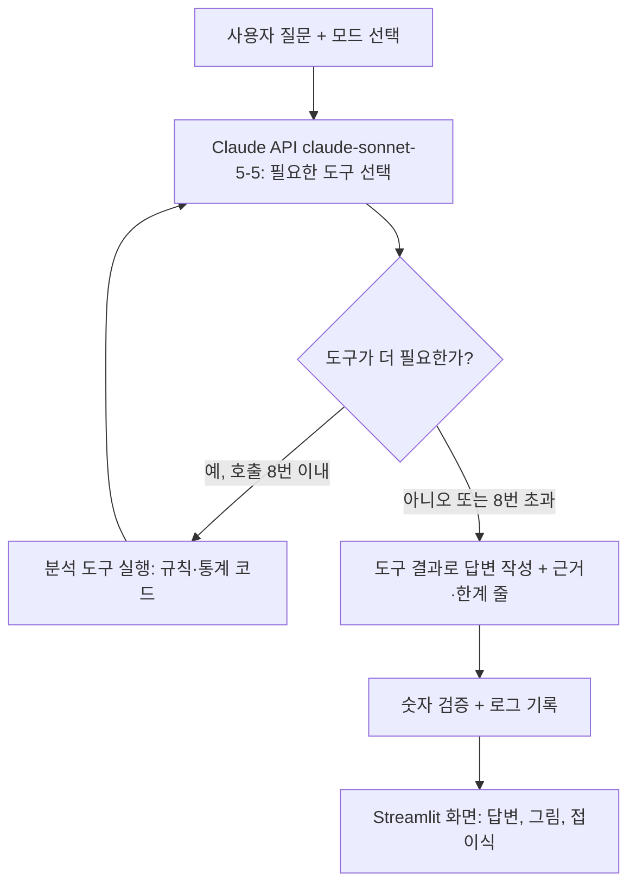

# 제주 삼다수 취수원 지하수 Agent 기획서

제주 AI·빅데이터 활용 AI Agent 개발 챌린지 | 작성자: 황보민

---

## ① 구현목표

### 분석 주제
- 제주개발공사가 공개한 지하수 감시정 센서 데이터(수위·수온)와 기상 데이터(강수)로 삼다수 취수원(표선유역) 지하수 상태를 말로 묻고 답하는 AI Agent 구현
- 제조 공기업(제주개발공사)의 취수원 감시 센서 데이터에 설비 모니터링 방식(이상 유형 진단, 상태 진단, 예측)을 적용

### AI를 활용한 데이터 분석 목표
1. 센서 이상 진단: 믿기 어려운 측정 구간(순간 튐, 계단 변화, 값 고착, 추세 이탈, 변동성 변화)을 먼저 찾아 '의심'으로 표시
2. 상태 진단: 18개월 관측 안에서 지하수가 낮은 쪽인지, 빠르게 내려가는지 보고 정상·주의·경고로 안내
3. 2주 예측: 앞으로 1~14일 측정값을 강수 가정 3가지(무강수 / 관측 기간 중앙값 / 상위 10%)별로 예측하고 예상 범위와 신뢰도를 함께 제시
4. 설명: 사용자가 말로 물으면 Agent가 분석 도구를 골라 부르고 결과를 쉬운 말과 차트로 설명

분석 계산은 규칙과 통계 모델이 하고, LLM은 도구 선택과 결과 설명만 담당함.

---

## ② 서비스 제안

### 데이터 활용 개요
- 감시정 6곳(1수원 감시정1~3, 2수원 감시정1~3)의 시간별 수위·수온 13,104시간(2022-01-01 00:00 ~ 2023-06-30 23:00)
- 같은 기간 제주 기상 관측소의 일 강수량 546일
- 관측소는 고도에 따라 해안(200 m 미만) 19곳, 중산간(200~700 m) 8곳, 산지(700 m 이상) 8곳으로 구분

### 물 관리 담당자가 쓸 이유
- 제주도는 대표 관측정의 수위를 기준으로 단계별 제한 조치를 하는 지하수 관리제도를 운영함. (제주도 지하수 관리수위 설정에 관한 연구, 2005, https://koreascience.kr/article/JAKO200518718194061.page)
- 2026년에도 가뭄으로 제주시 수리계 28곳이 농업용수 제한급수를 함. (https://m.seoul.co.kr/news/society/2026/08/06/20260806500068)
- 지하수는 제주의 주된 물 공급원이나 공개된 감시 데이터를 비전문가가 직접 읽고 해석하기 어려움
- 센서 값을 믿어도 되는지, 지금 평소보다 낮은지, 비가 안 오면 어떻게 되는지를 말로 묻고 근거와 함께 답을 받을 수 있음
- 공식 단계 판정을 대신하지 않고, 같은 방식의 판단을 돕는 도구로 제안

### 핵심 기능
센서 이상 진단, 상태 진단, 2주 예측 순서로 구성

1) 센서 이상 진단 (`src/sensor_check.py`)
- 5가지 유형을 찾고 원인은 단정하지 않으며, 모든 판정에 '의심'을 붙임
- 변화 속도, 지속 시간, 다른 감시정과 동시 발생 여부, 직전 7일 강수를 근거로 표시
- 임계값은 직전 7일 99% 값의 배수와 고정 하한 중 큰 값
- 18개월 동안 이벤트 47건(값 고착 16, 계단 변화 7, 변동성 변화 14, 순간 튐 5, 추세 이탈 5)
- 1수원 감시정3의 큰 변화 두 번(2022-09, 2023-05)을 변동성 변화 유형이 큰 비 직후 먼저 알림

[그림 1: 수위 차트와 센서 이상 의심 구간 — data/processed/sensor_events_level.png]

2) 상태 진단 (`src/status_check.py`)
- 물 높이 백분위 10% 이하는 경고, 25% 이하는 주의
- 최근 7일 하강 속도가 자기 기록 중 가장 빠른 2.5% 안이면 경고로 올리되, 백분위 50% 이하일 때만 적용
- 2023-06-30 기준 6곳 모두 정상이며 1수원 감시정3만 '측정값 신뢰도 낮음 가능성'이 함께 표시됨
- 등급은 공식 기준수위가 아닌 18개월 관측 안의 상대 위치

[그림 2: 감시정별 상태 등급 — data/processed/status_levels.png]

3) 2주 예측 (`src/forecast.py`)
- 릿지 회귀(numpy)에 과거 30일 누적 강수와 미래 h일 누적 강수를 입력하고, 예측 일수(h)마다 모델을 따로 구성
- 2주 수위는 앞으로 올 비보다 최근 30일간 이미 내린 비가 좌우함. 그래서 과거 30일 누적 강수를 핵심 입력으로 사용
- 시험 구간(2023-04~06)에서 5개 감시정의 14일 뒤 오차가 직전 값 유지 대비 약 31~47% 감소
- 1수원 감시정3은 변화 폭이 커서 '큰 변화 구간에서 오차가 큼' 신뢰도 표시로 구분
- 예상 범위는 과거 예측 오차(2023-01~03)의 10~90% 구간 기준

[그림 3: 2주 예측 시험 구간 오차 — data/processed/forecast_eval_v1.png]

### 편의성
- 질문 예시: "2수원 감시정1 지금 상태 어때?", "1수원 감시정3 값 믿어도 돼?", "이상한 감시정 있으면 알려줘.", "비가 안 오면 2주 뒤에 어떻게 돼?", "요즘 지하수 괜찮아?" (사이드바 예시 버튼 6개)
- 담당자 모드: 수치와 근거를 자세히 제공
- 도민 모드: 표 없이 10줄 안쪽의 쉬운 말로 제공
- '개발자 정보 보기' 체크박스(기본 꺼짐): 꺼져 있으면 비용·시간·토큰과 추정 비용 합계를 숨김. '사용한 도구'는 담당자 모드에서 항상, 도민 모드에서는 체크박스를 켰을 때만 표시
- 모든 답변 끝에 근거와 한계를 한 줄씩 표시하고 기준 시점(2023-06-30)을 명시

[그림 4: 화면 첫 모습 — docs/images/screen_main.png]
[그림 5: 질문과 답변 화면 — docs/images/screen_answer.png]

### 분석 데이터 활용 방안
센터 활용 제안은 다음과 같음.
- 담당자가 점검 전에 "이상한 감시정 있으면 알려줘."로 센서 점검 우선순위 결정
- 새 공개 파일을 `data/raw`에 넣고 전처리부터 다시 실행하면 기준일이 마지막 시점으로 갱신
- 실시간 센서·기상 연결로 확장(향후 개선 방향)

---

## ③ Agent 개발 구성

### 역할·목표·Workflow
- 역할: 지하수 감시 데이터를 대신 탐색하고 분석 결과를 설명하는 도우미
- 목표: 질문에 필요한 도구를 골라 부르고 도구 결과로만 답변

[그림 6: Agent Workflow — docs/images/workflow.png]

### 사용 모델과 역할
- claude-sonnet-5-5(Claude API): 질문 이해, 도구 선택, 결과 설명. 예측·진단 계산은 하지 않음
- 생각 깊이(effort)는 medium, 도구 입력은 엄격한 스키마(strict)로 정의
- 모델 이름은 `.env`의 `ANTHROPIC_MODEL`에서 읽고 비어 있으면 claude-sonnet-5-5 사용

### 도구 7개와 입출력

| 도구 | 입력 | 출력 |
|---|---|---|
| get_overview | 기준일(없으면 2023-06-30) | 6개 감시정의 등급·백분위·7일 변화·최근 센서 이상·14일 예측 요약 |
| get_status | 감시정, 기준일 | 등급(정상/주의/경고), 근거, 2022년 같은 시기 비교, 최근 7일 센서 이상 |
| get_forecast | 감시정, 기준일, 예측 일수, 강수 시나리오 | 1·3·7·14일 뒤 예측, 예상 범위, 신뢰도, 시험 오차, 추세 비교 표시 |
| get_sensor_events | 감시정, 기간, 유형 | 센서 이상 의심 이벤트(최대 20건)와 전체 건수 |
| get_values | 감시정, 기간, 수위/수온 | 시작·끝 값, 최소·최대, 평균, 일별 중앙값 일부 |
| get_rainfall | 기간 | zone별 강수 합계와 가장 많이 온 날 |
| make_chart | 감시정, 기간, 수위/수온 | 선 그래프 PNG 경로(센서 이상 구간 음영) |

### 판단 및 자율 수행 범위
- Agent: 어떤 도구를 어떤 순서로 쓸지 결정. 여러 감시정을 묻는 질문은 get_overview를 먼저 호출
- 규칙·통계 모델: 이상 진단, 등급 판정, 예측, 강수 집계 등 모든 분석 계산
- 한도: 한 질문에 도구 최대 8번. 넘으면 지금까지의 결과로 답변
- 모르면 모른다고 답함: 수질·오염·공식 제한 단계 판정·취수량, 데이터 기간(2022-01-01 ~ 2023-06-30) 밖의 질문은 범위 밖으로 안내
- 센서 이상은 항상 '의심', 등급은 '18개월 안의 상대적 상태', 측정값은 '물까지의 깊이로 해석'했음을 필요할 때 함께 표시

---

## ④ 데이터 활용 계획

### 필수 데이터

| 번호 | 데이터명 | 출처 | 활용 항목 |
|---|---|---|---|
| 142 | 제주개발공사 지하수 감시정 지하수위 정보 | 제주데이터허브(jejudatahub.net) | 진단·예측·이상탐지 대상 |
| 79 | 제주개발공사 지하수 감시정 지하수온 정보 | 제주데이터허브 | 수온 값 고착 탐지, 수위 이상 시 동시 변화 확인 |
| 756 | 일별 기상 정보 | 제주데이터허브(API) | 일 강수량(`dailyRainfall`)으로 수위 변화 설명·예측 입력 |
| 757 | 기상관측소 정보 | 제주데이터허브(API) | 관측소 목록, 고도 지역(zone) 구분 |

### 수집·전처리 방법
- 수위·수온: CSV 4개(수위·수온 × 2022·2023년)를 CP949로 읽고 시각 표기(`0:00` / `00:00`)와 수온 값 뒤 공백을 맞춰 하나의 시간별 표로 병합. 13,104행이며 빠진 시각·중복·결측 없음. 원본은 수정하지 않음
- 기상: 2022-01-01 ~ 2023-06-30 546일을 하루씩 수집. 502 오류는 같은 날짜를 최대 3번 재시도하고, 실패 날짜는 건너뛴 뒤 다시 시도. 2022-01-20은 응답이 0건이라 빈 날짜로 두고 채우지 않음
- zone 구분: 관측소 고도로 해안·중산간·산지를 나누고 zone별 일평균 강수 사용. 산지 강수는 해안의 약 2~4배
- 측정값 방향: 강수 뒤 값이 줄어드는 반응(상관 −0.36~−0.87)과 표선유역 연구(신문주 외, 2020)를 근거로 '물까지의 깊이'로 해석. 해석이 달라지면 `src/config.py` 한 줄로 전환되도록 설계

### 이용조건
- 허브에 별도 이용조건 표시가 없어 출처를 표기하고 대회 목적으로만 사용
- 제출 ZIP의 원본·가공 데이터는 대회 심사 목적으로만 포함하며 외부 공개·재배포를 금지
- 제출물에는 평가용 Claude API 키만 `.env`에 넣었고(사용 한도, 2026-11-30 만료, 평가 뒤 폐기), 허브 키는 넣지 않음

---

## ⑤ 개발·탑재 계획

### 구현 범위
- 센서 이상 진단, 상태 진단, 2주 예측, Agent(도구 7개), Streamlit 화면까지 구현
- 범위 밖: 실시간 수집, 취수량·수질 분석, 2주를 넘는 예측

### 기술 환경
- Python 3.12.2
- 라이브러리: anthropic 2.8.0, matplotlib 3.11.2, numpy 2.5.4, pandas 3.1.1, python-dotenv 1.2.4, requests 2.34.2, streamlit 1.66.1

### UI 구성 (Streamlit)
- 실행: `streamlit run src/app.py`
- 채팅 입력, 답변 말풍선, 답변 아래 그림과 접이식, 사이드바(모드 선택, 예시 질문 6개, 대화 지우기, 세션 지표, 개발자 정보 보기)
- 예측 모델 파일이 없으면 상단 안내와 '예측 모델 만들기(약 2분)' 버튼 표시

[그림 7: Agent가 만든 차트 화면 — docs/images/screen_chart.png]

### 센터 실행환경
- GPU 없이 CPU만 사용하며, 개발 PC(i5-1335U, RAM 16GB)에서 전처리·진단·예측 전 과정이 최대 메모리 150MB 이내로 동작. 센터 PC 사양(i7-8700, RAM 32GB) 안에서 충분
- Claude API 접속(인터넷)이 필요. 센터에서 api.anthropic.com 접속이 가능해야 함

| 작업(개발 PC 측정) | 소요 시간 | 최대 메모리 |
|---|---|---|
| 전처리 preprocess.py | 8.5초 | 98 MB |
| 센서 진단 sensor_check.py | 8.2초 | 144 MB |
| 상태 진단 status_check.py | 6.7초 | 142 MB |
| 예측 모델 forecast.py | 113.6초 | 133 MB |

- 모델 파일 68,463바이트, 시간별 데이터 약 1.2 MB
- 키 준비: 허브 인증키(JEJU_DATAHUB_KEY)와 Claude API 키(ANTHROPIC_API_KEY)를 `.env`에 입력. 허브 키는 기상 데이터를 새로 받을 때만 필요. 직접 실행할 때는 `.env.example`을 `.env`로 복사해 키를 채우며 발급 방법은 README에 수록. 제출물에는 평가용 Claude API 키만 `.env`에 넣었고(사용 한도, 2026-11-30 만료, 평가 뒤 폐기), 허브 키는 넣지 않음
- 질문 하나에 입력 약 3천~3만 토큰, 비용 약 0.01~0.1달러

---

## 향후 개선 방향
- 데이터가 2023-06-30까지이며, 새 파일을 `data/raw`에 넣고 전처리부터 다시 실행하면 기준일이 따라감
- 1수원 감시정3은 변화 폭이 커서 예측 신뢰도를 따로 표시함
- 예상 범위를 더 넓은 기간의 자료로 보정할 예정
- 실시간 센서 연결로 확장
